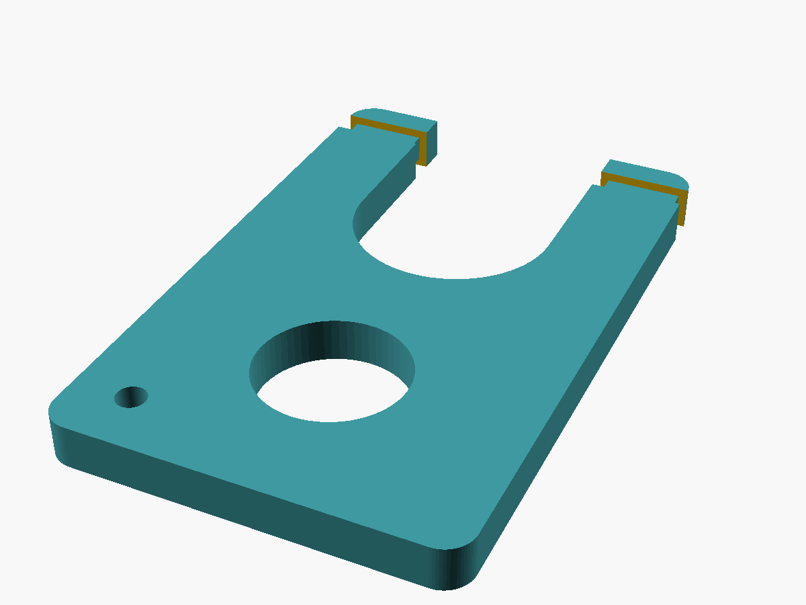
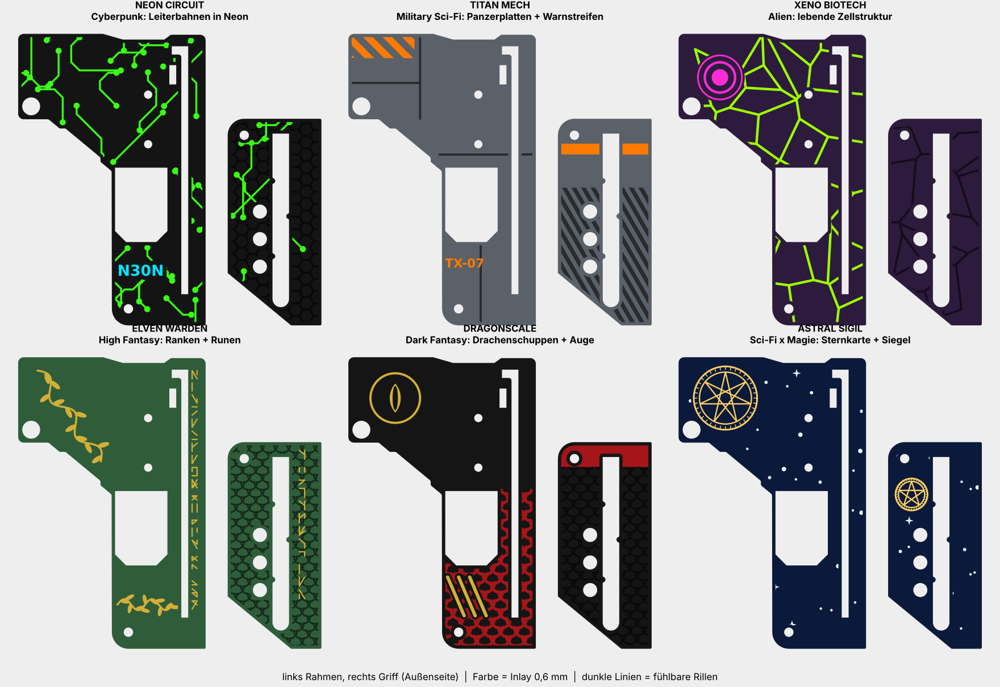

# Card Slingshot (parametrisch)

Eigenes, editierbares Modell einer Schleuder im Kreditkartenformat (54 × 85,6 mm), angelehnt an den Stil von „card style slingshots“. Es ist **keine** Kopie einer MakerWorld-Datei.

## Dateien
- `slingshot.scad`: Quelle. In [OpenSCAD](https://openscad.org) öffnen, oben die Werte ändern (oder im Customizer-Panel), dann F6 → Export STL.
- `slingshot.stl`: druckfertige Datei mit den Standardwerten.

## Wichtige Parameter
| Parameter | Standard | Wirkung |
|---|---|---|
| `thickness` | 6 | Dicke; mehr = stabiler |
| `gap_w` / `gap_depth` | 28 / 40 | Gabelöffnung |
| `band_style` | `"groove"` | `"groove"` = umwickeln + binden, `"slot"` = Flachband durchfädeln, `"none"` |
| `finger_d` | 20 | Fingerloch, 0 = keins |
| `lanyard_d` | 4 | Loch für Schlaufe, 0 = keins |
| `label` | `""` | eingravierter Text |

Über die Kommandozeile: `openscad -o out.stl -D 'thickness=8' -D 'band_style="slot"' slingshot.scad`

## Druck
Flach liegend drucken, 100 % Infill oder ≥ 5 Wände, PETG oder PA-CF statt PLA. Mit leichten Bändern anfangen. Nie auf Menschen oder Tiere zielen.

---

# Moshu Card Slingshot – Designs

Farb- und Haptik-Designs für die [Moshu Card-Style Slingshot](https://makerworld.com/de/models/3087259) (Original-Geometrie vom Designer, **nicht** in diesem Repo).

1. Die 3MF bei MakerWorld herunterladen.
2. `python3 moshu/tools/extract_3mf.py <datei>.3mf moshu/parts` (benötigt `numpy`). Das erzeugt die einzelnen STLs, die lokal bleiben.
3. Konzeptblatt: `python3 moshu/tools/designs.py sheet moshu/designs/concepts.png` (benötigt `trimesh shapely scipy matplotlib`).

Teile: `frame` (Rahmen), `grip` (Griff mit Kugelkanal), `slider` (Schlitten/Abzug), `spring` (Druckfeder), `cover_plate`, `nut_plate` (2× M3-Mutter), `screw_plate` (2× M3-Senkkopf), `knob` (Knopf mit Öse).
Original-Druckprofil: Bambu Lab A1, 0,2 mm, 3 Wände, 40 % Infill, ohne Stützen.
